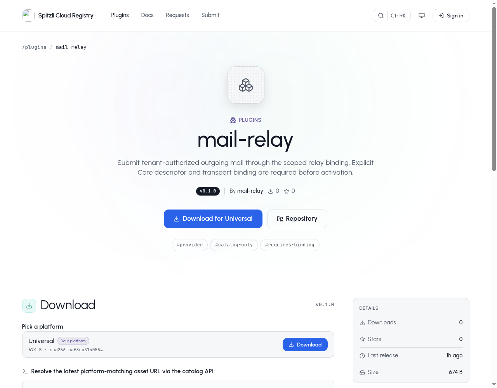

# Mail Relay


Provide the private relay transport used by the platform’s durable outgoing Mail workflow.

## What you can do

Validate and submit a bounded MIME message to the approved relay API using one authorized attempt.

## Setup and access

Operator integration only. Requires Core-admitted descriptor SHA-256, exact release version, private worker/Core peer pins and a customer-scoped named send binding. Catalog publication alone does not install or activate this specialized runtime.

## Data and security

Provider credentials arrive only after Core authorizes a one-use attempt. MIME and envelope data are checked again; BCC stays envelope-only. Unknown outcomes are retained as uncertain and must not trigger an automatic duplicate send.

## Status and limits

Beta integration without a customer-facing plugin panel. Requests must fit the provider’s 24 MB ceiling. Full installation and durable callback qualification remain separate gates; no live message is sent by local tests.

Catalog publication does not activate the plugin, enable public signup or grant
access to any customer resource. A new presentation release must use a new version;
previously signed releases and their assets stay immutable.

## Gallery

Actual public catalog v0.1.0, captured before this presentation release. Catalog-only; explicit runtime binding required, no customer UI.



## Catalog source

`.tabularium` is the complete catalog-refresh source. It retains the immutable
runtime image and full protocol/access contract of the currently released
`0.1.0` and adds the prepared presentation assets. Refresh it only from a
reviewed immutable source commit. This does not replace signed release assets
or activate the runtime.

## Technical reference

The retained implementation notes below include platform integration procedures.
Commands referring to Core, `tools/` or `apps/console` require the [platform source
checkout](https://github.com/spitzli/webdock); they are not standalone setup steps.

This independent Rust workspace implements the retained relay provider's send API. Core does not depend on it. Shared `webdock-mail-message` supplies message validation/MIME sanitation; `webdock-mail-protocol` supplies tenant/job leases and authenticated streaming. The shared DB-free `webdock-plugin-http` transport uses Reqwest/Rustls for named, address-pinned HTTPS requests without redirects or automatic retries.

Build with `cargo build --manifest-path Cargo.toml --release --locked`. The binary takes exactly one absolute, owned, private configuration file. The file contains `pluginID`, semantic `version`, `generation`, `descriptorSha256`, `issuerPublicKeyHex`, `worker`, `corePeer`, `listen` and `core`. It contains no tenant's relay key. Configuration is bounded to 64 KiB; symlinks, shared permissions and multiply linked files are rejected.

- `worker` and `corePeer` are independent exact peer bindings: `{ "kind":"unix", "uid":65532 }` or `{ "kind":"mutualTls", "certificateSha256":"<enrolled-leaf-sha256>" }`.
- `listen` is `{ "kind":"unix", "path":"/run/webdock-mail/relay.sock" }`, or explicit `mutualTls` with `address`, `certificate`, `privateKey`, `authority` paths. The Unix parent must be owned, canonical and private.
- `core` is a private Unix path or explicit pinned `mutualTls` with `origin`, `domain`, `certificate`, `privateKey`, `authority` and `certificateSha256`. PEM files must be owned and bounded; client keys must be private. Server verification requires normal CA/hostname/validity checks and the enrolled leaf fingerprint.

`Describe` returns only static protocol/release metadata to the configured Core peer, including before activation. It cannot send messages. `Submit` requires a signed 60-second Mail lease, the configured worker peer, current Core authorization, a verified bounded MIME stream, and Core's one-use attempt acknowledgement. Only that acknowledgement releases the private provider configuration (`binding`: the approved named `HttpBinding`, including tenant-scoped credential headers). It is never returned to the worker or browser.

The provider accepts only the documented EU/global HTTPS origins and the fixed send path. Core selects the customer’s `send` binding; its approved addresses, method/path/query rules, CA and credential headers are enforced by the shared transport. Provider payloads cannot choose another destination. MIME/envelope data is validated again, BCC remains envelope-only, and a message must fit the provider's 24 MB request ceiling. Large decimal provider IDs remain strings without floating-point conversion. Documented definitive rejection classes release the attempt as rejected; lost replies, malformed successes, redirects, 5xx and timeouts are unknown. `reference_id` is correlation and does not authorize a retry.

Contract checked against [the provider's official API](https://serversmtp.com/turbo-api/turbo-smtp.yaml). No real provider credentials or external messages are used in tests:

```sh
cargo test --manifest-path Cargo.toml --locked --features local-provider-test
cargo clippy --manifest-path Cargo.toml --all-targets --features local-provider-test -- -D warnings
```

The test-only feature permits an exact local HTTPS fixture with its explicit CA and pinned 127.0.0.1 address. Production builds have no endpoint override. Tests cover a separate provider subprocess, real private gRPC callbacks/streaming, one external HTTPS attempt, replay/revocation denial, private configuration, wide provider IDs and uncertain receipts. The test authority is isolated; complete platform installation, durable Core callback integration and full provider-management parity are tracked in the platform ledger.
